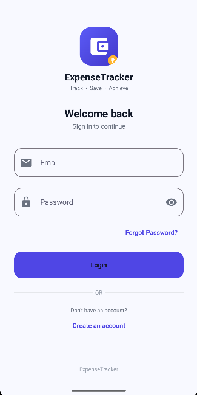
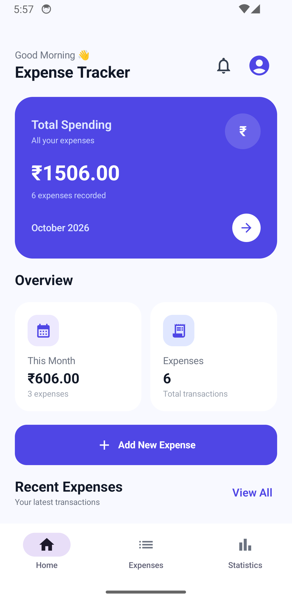
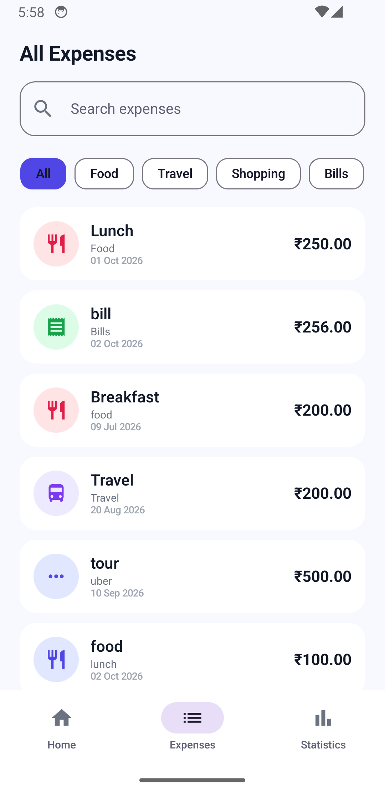
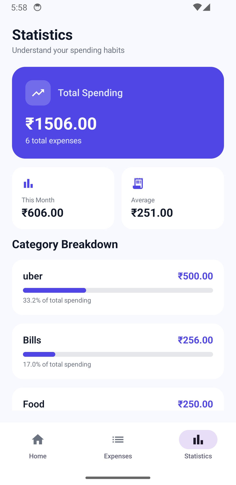
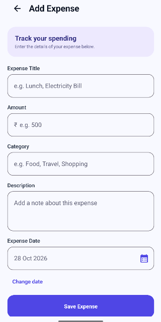
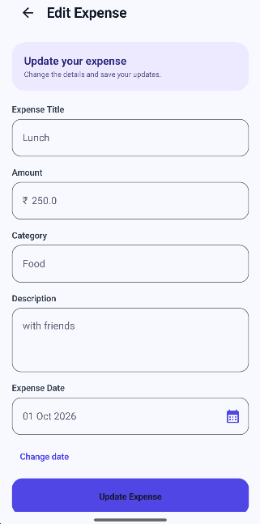
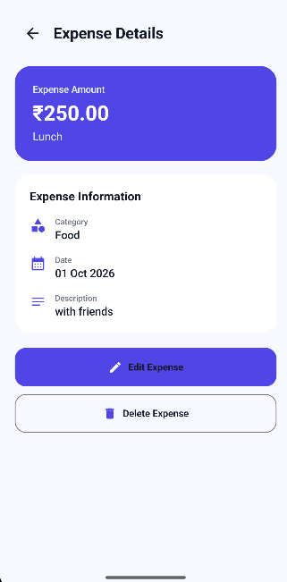
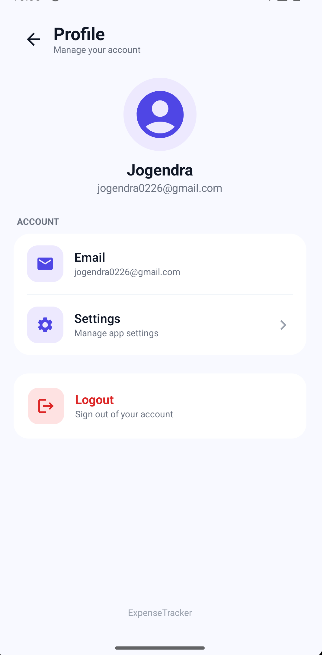

# ExpenseTracker

A modern Android expense tracking application built with Kotlin and Jetpack Compose.

ExpenseTracker allows users to securely manage personal expenses, view spending statistics, search expenses, edit or delete records, and manage their account through Firebase Authentication.

---

## 📱 Features

- User Registration
- User Login
- Firebase Authentication
- Add Expense
- Edit Expense
- Delete Expense
- Expense Details
- Expense Categories
- Expense Description
- Expense Date Selection
- Search Expenses
- Total Spending
- Monthly Spending Summary
- Expense Statistics
- Category-wise Spending
- Recent Expenses
- Notifications Screen
- Profile Screen
- Settings Screen
- Dark Mode
- Material 3 UI
- Bottom Navigation
- Local Offline Expense Storage

---

## 🛠️ Tech Stack

### Programming Language

- Kotlin

### Android

- Android SDK
- Android Studio
- Jetpack Compose
- Material 3
- Android Jetpack
- Navigation Compose
- ViewModel
- StateFlow
- Coroutines

### Architecture

- MVVM
- Repository Pattern
- Clean Architecture concepts

### Local Database

- Room Database
- SQLite

### Authentication

- Firebase Authentication

### Dependency Injection

- Hilt

### Build System

- Gradle
- Kotlin DSL
- KSP

### UI

- Jetpack Compose
- Material 3
- Material Icons
- Dark Mode

### Development Tools

- Git
- GitHub
- Android Studio

---

## 🏗️ Architecture

The application follows an MVVM-based architecture.

```text
UI
 │
 ▼
ViewModel
 │
 ▼
Repository
 │
 ▼
DAO
 │
 ▼
Room Database
 │
 ▼
SQLite
```

---

## 📸 Screenshots

Here are the key screens of ExpenseTracker:

| Login Screen | Home Screen | Expenses Screen | Statistics Screen |
| :---: | :---: | :---: | :---: |
|  |  |  |  |

| Add Expense Screen | Edit Expense Screen | Expense Details Screen | Profile Screen |
| :---: | :---: | :---: | :---: |
|  |  |  |  |